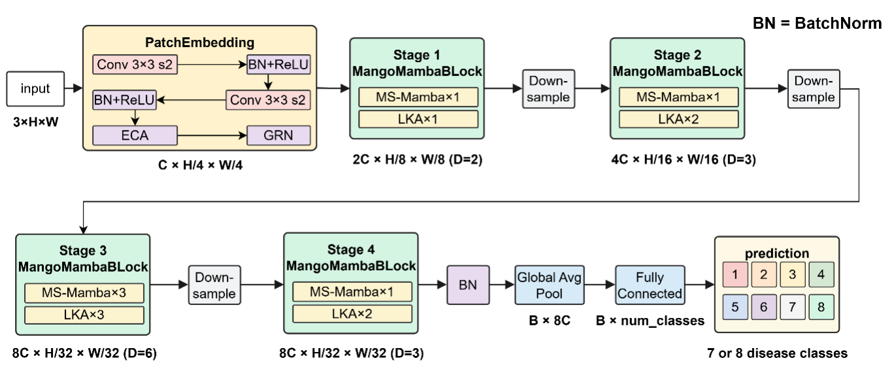
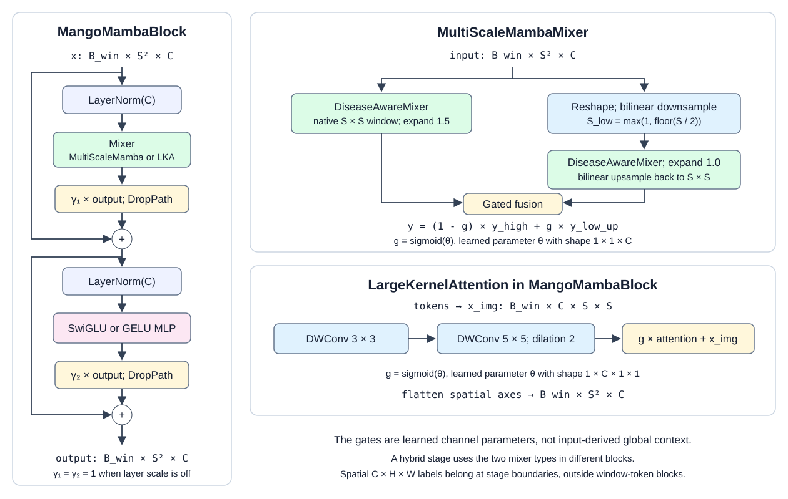
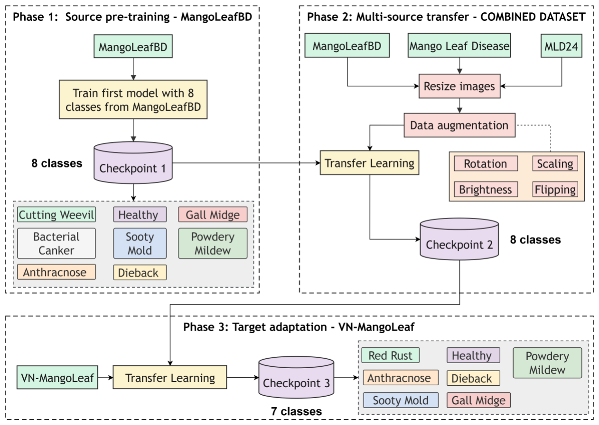
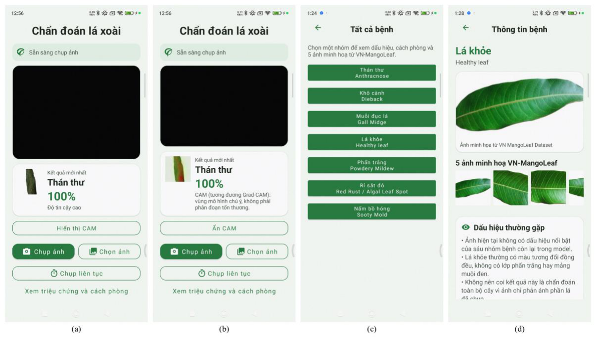
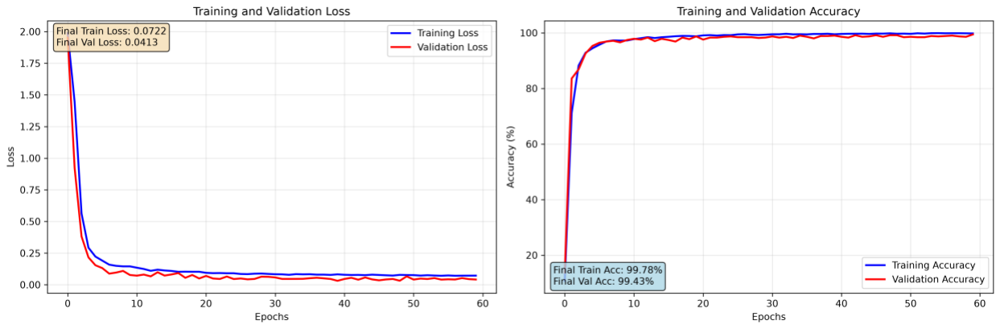
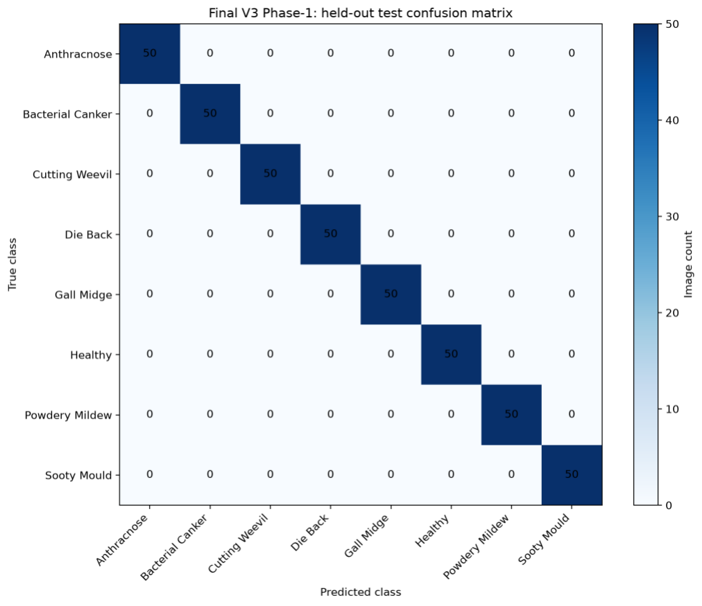
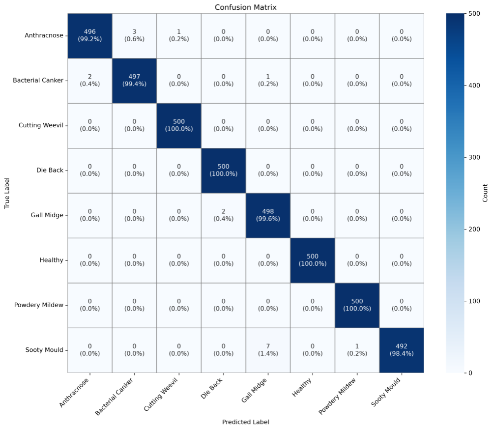
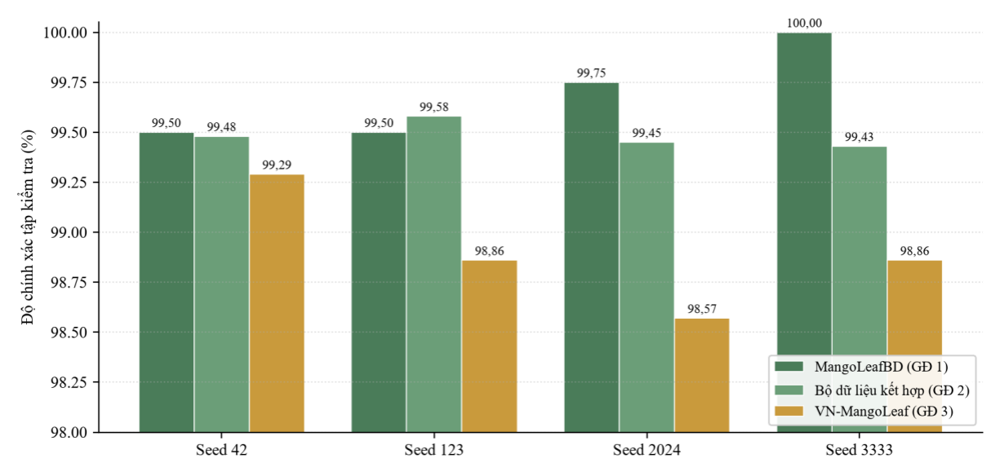
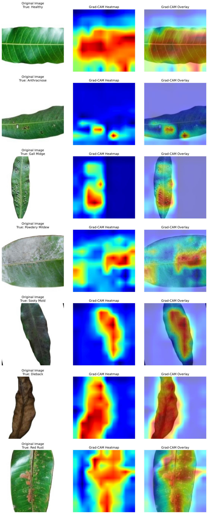
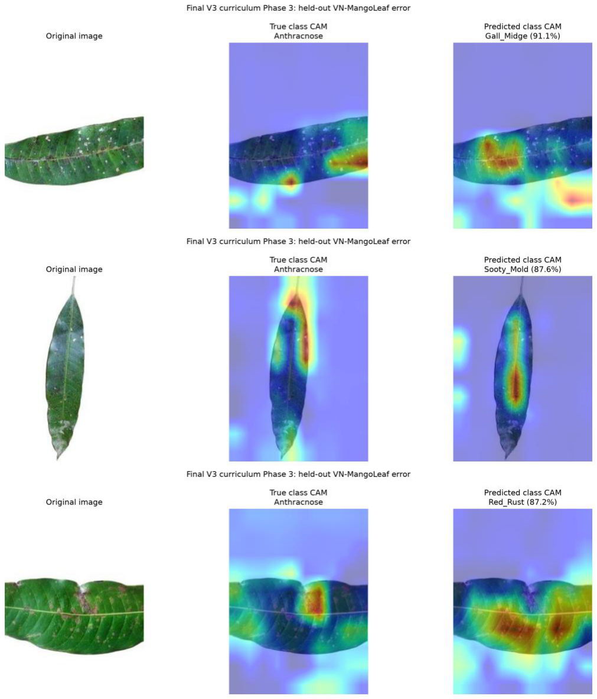

# MangoMamba - Cài đặt và chạy thực nghiệm

## Mục lục

| Mục | Nội dung |
|---|---|
| [1. Tổng quan](#tong-quan) | Phạm vi, kết quả và cấu trúc repository |
| [2. Kiến trúc và quy trình](#kien-truc) | Hình 3.1, 3.2, 3.3 và mã liên quan |
| [3. Môi trường và cài đặt](#cai-dat) | Cài đặt trên Windows/WSL2 hoặc Linux |
| [4. Dữ liệu và checkpoint](#du-lieu) | Split, ánh xạ nhãn, vị trí dữ liệu và trọng số |
| [5. Script Python chính](#scripts) | Mục đích và đầu ra của các file cần dùng |
| [6. Chạy thực nghiệm](#chay-thuc-nghiem) | Ba giai đoạn, direct-VN, năm ablation và bốn seed |
| [7. Tổng hợp kết quả](#ket-qua) | Xuất thống kê từ kết quả bốn seed |
| [8. Hình thực nghiệm](#hinh-thuc-nghiem) | Biểu đồ, CAM và giao diện Android |
| [9. Phân tích và đo GPU](#phan-tich) | Phân tích lỗi, ghép hình, latency FP32 |
| [10. ONNX và Android](#android) | Xuất model CAM, build và kiểm tra thiết bị |
| [11. Tài liệu tham khảo](#nguon) | Bài báo Mango-Mamba and VN-MangoLeaf |

<a id="tong-quan"></a>

## 1. Tổng quan và cấu trúc repository

Mô hình chính dùng ảnh 320×320, cửa sổ `[8,8,5,5]`, hybrid Mamba/LKA, ECA/GRN/SwiGLU. Nghiên cứu ablation các thành phần dùng ảnh 224×224, cửa sổ `[8,8,14,7]`.

| Thực nghiệm | Tập kiểm tra | Test Accuracy, bốn seed (%) |
|---|---:|---:|
| Giai đoạn 1: MangoLeafBD | 400 ảnh | 99,69 ± 0,24 |
| Giai đoạn 2: Bộ dữ liệu kết hợp | 4.000 ảnh | 99,48 ± 0,07 |
| Giai đoạn 3: VN-MangoLeaf | 700 ảnh | 98,89 ± 0,29 |
| Tinh chỉnh trực tiếp phase 1 -> VN-MangoLeaf | 700 ảnh | 98,11 ± 0,55 |

Các số trên được tính từ `training_results.json → test_metrics` của checkpoint có validation loss nhỏ nhất trong từng lượt. Độ lệch chuẩn là sample SD giữa seed `42, 123, 2024, 3333`; Precision/Recall/F1 dùng trung bình weighted.

| Vị trí | Nội dung |
|---|---|
| [code/](code/) | Model, trainer, runner, phân tích, đo latency, xuất ONNX và ghép hình |
| [experiments/](experiments/) | 36 lượt kết quả; mỗi case/seed ở một thư mục trực tiếp |
| [environment/](environment/) | Requirements, script cài, bản xuất môi trường và log kiểm tra |
| [docs/figures/](docs/figures/) | Sơ đồ mô hình và hình kết quả thực nghiệm |
| [android/](android/) | Ứng dụng Android dùng model 320px có CAM |
| [datasets/](datasets/) | ZIP dữ liệu và manifest checksum |
| `data/` | Dữ liệu ảnh sau khi giải nén |
| `runs/` | Output dành cho lượt chạy mới |

<a id="kien-truc"></a>

## 2. Kiến trúc và quy trình huấn luyện

### 2.1. Kiến trúc tổng thể (Hình 3.1)



Mã mô hình: [mango_mamba.py](code/mango_mamba.py).

### 2.2. Cấu trúc block



Sơ đồ theo [mango_mamba.py](code/mango_mamba.py): block nhận chuỗi `B_win × S² × C`; gate trong hai mixer là tham số học được theo kênh.

### 2.3. Học theo chương trình ba giai đoạn (Hình 3.3)



Quy trình chạy: [run_curriculum.py](code/run_curriculum.py).


<a id="cai-dat"></a>

## 3. Môi trường và cài đặt

Huấn luyện cần GPU NVIDIA tương thích CUDA 13.0. Trên Linux, dùng terminal trực tiếp; trên Windows, chạy trong WSL2 Ubuntu. Việc tổng hợp JSON ở mục 7 chỉ cần Python.

| Thành phần | Phiên bản |
|---|---|
| Python | 3.12 |
| PyTorch / torchvision | 2.13.0+cu130 / 0.28.0+cu130 |
| CUDA Toolkit | 13.0, có `nvcc` |
| mamba-ssm / timm / einops | 2.3.2.post1 / 1.0.28 / 0.8.2 |

### 3.1. Windows

Cài [WSL2](https://learn.microsoft.com/en-us/windows/wsl/install) trong PowerShell với quyền Administrator:

```powershell
wsl --install -d Ubuntu-24.04
wsl --update
```

Khởi động lại nếu được yêu cầu, mở Ubuntu rồi làm tiếp mục 3.2. Cài driver NVIDIA trên Windows và CUDA Toolkit trong WSL theo [hướng dẫn NVIDIA](https://docs.nvidia.com/cuda/wsl-user-guide/index.html); không cài driver Linux vào WSL.

### 3.2. Linux hoặc Ubuntu trong WSL2

Sau khi clone repo, mở terminal tại thư mục `Mango-Mamba`. Cài Python 3.12 và công cụ biên dịch; ví dụ trên Ubuntu 24.04:

```bash
sudo apt-get update
sudo apt-get install -y python3.12-venv python3.12-dev build-essential git git-lfs libgl1 libglib2.0-0
```

Cài CUDA Toolkit 13.0 theo [hướng dẫn NVIDIA](https://docs.nvidia.com/cuda/cuda-installation-guide-linux/), rồi kiểm tra và tạo môi trường:

```bash
nvidia-smi
export CUDA_HOME="${CUDA_HOME:-/usr/local/cuda-13.0}"
export PATH="$CUDA_HOME/bin:$PATH"
nvcc --version
bash environment/setup_linux.sh
source .venv-mango/bin/activate
```

Script cài các gói đã khóa phiên bản và kiểm tra mô hình bằng dữ liệu ngẫu nhiên. Nếu CUDA Toolkit nằm ở nơi khác, đặt `CUDA_HOME` trước khi chạy. Trên ARM64, script sửa tag đóng gói cuSPARSELt 0.8.1 đã xác nhận sai, giữ nguyên binary rồi chạy `pip check`. Script dừng khi `.venv-mango` đã tồn tại; dùng `bash environment/setup_linux.sh .venv-new` để tạo môi trường khác.

Để xuất ONNX, cài thêm:

```bash
python -m pip install -r environment/requirements-export.txt
```

<a id="du-lieu"></a>

## 4. Dữ liệu và checkpoint

Dữ liệu nằm trong [mango_mamba_datasets.zip](datasets/mango_mamba_datasets.zip), gồm 51.000 ảnh và sáu file metadata, giữ nguyên tên lớp và split. ZIP và checkpoint được lưu bằng [Git LFS](https://git-lfs.com/); cài client trước khi dùng các lệnh sau tại gốc repo:

```bash
git lfs install
git lfs pull --include="datasets/*.zip,experiments/**/model_best.pth.tar" --exclude=""
python -m zipfile -e datasets/mango_mamba_datasets.zip .
```

Lệnh giải nén tạo `data/<bộ_dữ_liệu>/{train,val,test}/<tên_lớp>/`. Các lệnh trên dùng được trong PowerShell, Linux hoặc WSL2 khi đã cài Git LFS và Python.

| Thư mục | Số lớp | Train | Val | Test |
|---|---:|---:|---:|---:|
| `data/mangoleafBD` | 8 | 3.200 | 400 | 400 |
| `data/combined_dataset` | 8 | 32.000 | 4.000 | 4.000 |
| `data/vn_mangoleaf` | 7 | 5.600 | 700 | 700 |

[Manifest dữ liệu](datasets/mango_mamba_datasets.manifest.json) ghi SHA-256 của ZIP và từng file; [file checksum](datasets/mango_mamba_datasets.zip.sha256) dùng để kiểm tra bản tải về.

Repo có 36 file kết quả và 16 checkpoint của phase 1, phase 2, phase 3 và direct-VN. Các lượt ablation hiện có kết quả nhưng thiếu checkpoint.

<a id="scripts"></a>

## 5. Các script Python chính

| File trong `code/` | Mục đích |
|---|---|
| [mango_mamba.py](code/mango_mamba.py) | Định nghĩa mô hình; được các script khác import. |
| [train_mango_mamba.py](code/train_mango_mamba.py) | Huấn luyện một lượt, lưu checkpoint, chỉ số, đường cong và Grad-CAM. |
| [run_curriculum.py](code/run_curriculum.py) | Chạy ba giai đoạn, direct-VN hoặc ablation theo seed. |
| [summarize_thesis_results.py](code/summarize_thesis_results.py) | Tổng hợp mean và sample SD từ bốn seed của mỗi cấu hình. |
| [analyze_vn_errors.py](code/analyze_vn_errors.py) | Xuất chỉ số từng lớp, danh sách ảnh sai và CAM trên VN-MangoLeaf. |
| [measure_gpu_latency.py](code/measure_gpu_latency.py) | Đo latency GPU và đánh giá checkpoint trên MangoLeafBD. |
| [render_thesis_figures.py](code/render_thesis_figures.py) | Ghép biểu đồ theo seed, Grad-CAM và các panel dự đoán sai. |
| [export_android_cam.py](code/export_android_cam.py) | Xuất ONNX có logits và feature map để hiển thị CAM trên Android. |
| [check_environment.py](code/check_environment.py) | Kiểm tra import, AMP forward/backward và suy luận FP32. |

<a id="chay-thuc-nghiem"></a>

## 6. Chạy thực nghiệm

Các lệnh sau chạy trong Linux hoặc WSL2, sau khi kích hoạt venv. Runner dùng AdamW, learning rate `0.0005`, batch 64, tích lũy gradient 4 bước, AMP, tối đa 100 epoch và early stopping theo validation loss với patience 20.

| Task | Dữ liệu và khởi tạo |
|---|---|
| `phase1` | MangoLeafBD, 8 lớp, huấn luyện từ đầu |
| `curriculum` | Phase 1 -> Combined (8 lớp) -> VN-MangoLeaf (7 lớp), cùng seed |
| `direct-vn` | Phase 1 -> VN-MangoLeaf, bỏ qua Combined |
| `ablation` | MangoLeafBD 224px; `full`, `no_eca`, `no_grn`, `no_swiglu`, `hybrid_minimal` |

### 6.1. Chọn dữ liệu, output và seed

Tại thư mục gốc repo, đặt các biến dùng chung cho các lệnh bên dưới:

```bash
DATA_ROOT="$PWD/data"
OUT="$PWD/runs/reproduce"
SEED=42
```

Thay `DATA_ROOT` nếu dữ liệu nằm ngoài repo. Chạy từng lệnh trong cùng terminal và chờ lệnh trước hoàn tất. Với mỗi seed, mục 6.2 đến 6.5 tạo chín lượt thực nghiệm. Để đủ 36 lượt, chạy với `SEED=42`, sau đó lần lượt đặt `SEED=123`, `SEED=2024`, `SEED=3333` và lặp lại các mục này; giữ nguyên `OUT`.

### 6.2. Phase 1: MangoLeafBD

Huấn luyện từ đầu trên MangoLeafBD. Checkpoint đầu ra được dùng cho curriculum và direct-VN cùng seed.

```bash
python code/run_curriculum.py --task phase1 --seed "$SEED" \
  --data-root "$DATA_ROOT" --output "$OUT"
```

### 6.3. Phase 2 và phase 3: Combined -> VN-MangoLeaf

Sau khi phase 1 hoàn tất, chạy hai giai đoạn kế tiếp. Runner chờ phase 2 hoàn tất rồi dùng checkpoint của nó để huấn luyện phase 3.

```bash
python code/run_curriculum.py --task curriculum --seed "$SEED" \
  --data-root "$DATA_ROOT" --output "$OUT"
```

### 6.4. Direct-VN: Phase 1 -> VN-MangoLeaf

Dùng checkpoint phase 1 để tinh chỉnh trực tiếp trên VN-MangoLeaf, bỏ qua Combined. Lượt này độc lập với phase 2 và phase 3.

```bash
python code/run_curriculum.py --task direct-vn --seed "$SEED" \
  --data-root "$DATA_ROOT" --output "$OUT"
```

### 6.5. Các thực nghiệm ablation

Các cấu hình dưới đây huấn luyện từ đầu trên MangoLeafBD ở 224px, không phụ thuộc checkpoint của các phase. Mỗi khối là một lệnh riêng.

Cấu hình đầy đủ (`full`):

```bash
python code/run_curriculum.py --task ablation --case full --seed "$SEED" \
  --data-root "$DATA_ROOT" --output "$OUT"
```

Bỏ ECA (`no_eca`):

```bash
python code/run_curriculum.py --task ablation --case no_eca --seed "$SEED" \
  --data-root "$DATA_ROOT" --output "$OUT"
```

Bỏ GRN (`no_grn`):

```bash
python code/run_curriculum.py --task ablation --case no_grn --seed "$SEED" \
  --data-root "$DATA_ROOT" --output "$OUT"
```

Bỏ SwiGLU, dùng GELU MLP (`no_swiglu`):

```bash
python code/run_curriculum.py --task ablation --case no_swiglu --seed "$SEED" \
  --data-root "$DATA_ROOT" --output "$OUT"
```

Bỏ cả ECA, GRN và SwiGLU (`hybrid_minimal`):

```bash
python code/run_curriculum.py --task ablation --case hybrid_minimal --seed "$SEED" \
  --data-root "$DATA_ROOT" --output "$OUT"
```

Mỗi lượt lưu `args.yaml`, `training_results.json`, `model_best.pth.tar`, `train.log` và các hình kết quả. Runner bỏ qua lượt đã hoàn tất có đủ JSON/checkpoint và resume từ `last.pth.tar` của epoch cuối. Resume đầy đủ chỉ áp dụng cho checkpoint mới có trạng thái optimizer, scheduler, RNG và early stopping; checkpoint cũ dùng để khởi tạo lượt mới. Muốn chạy từ đầu, chọn thư mục output mới.

<a id="ket-qua"></a>

## 7. Tổng hợp kết quả

```bash
# Kết quả có sẵn trong repo:
python code/summarize_thesis_results.py --experiments experiments > results.csv

# Kết quả vừa huấn luyện:
python code/summarize_thesis_results.py --experiments runs/reproduce > rerun_results.csv
```

Script đọc đủ bốn seed cho mỗi nhóm và lấy chỉ số từ `test_metrics`. Accuracy, Precision, Recall và F1 được đổi sang phần trăm; độ lệch chuẩn dùng mẫu số `n-1`. Precision/Recall/F1 là weighted. Cột `last_epoch_val_loss` là validation loss epoch cuối, không phải loss dùng chọn checkpoint tốt nhất.

<a id="hinh-thuc-nghiem"></a>

## 8. Hình kết quả và nguồn dữ liệu

Các hình dưới mô tả từng checkpoint hoặc nhóm kết quả đã lưu trong repo. Chúng không thay thế thống kê trung bình bốn seed ở mục 1.

### 8.1. Giao diện Android



Mã giao diện: [MainActivity.kt](android/app/src/main/java/com/mangomamba/benchmark/MainActivity.kt). Model và ánh xạ nhãn được mô tả trong [manifest runtime](android/app/src/main/assets/mango_mamba_v3_phase3_320_cam_manifest.json).

### 8.2. Đường cong huấn luyện



Nguồn: [training_curves.png](experiments/04_phase3_vn_mangoleaf_320_seed_42/training_curves.png), phase 3 seed 42; tạo bởi [trainer](code/train_mango_mamba.py).

### 8.3. Ma trận nhầm lẫn MangoLeafBD



Nguồn: [phase 1 seed 3333](experiments/01_phase1_mangoleafbd_320_seed_3333/confusion_matrix_test.png), đúng 400/400 ảnh test.

### 8.4. Ma trận nhầm lẫn Bộ dữ liệu kết hợp



Nguồn: [phase 2 seed 123](experiments/03_phase2_combined_320_seed_123/confusion_matrix_test.png), accuracy 99,575% trên 4.000 ảnh test.

### 8.5. Ma trận nhầm lẫn VN-MangoLeaf


Nguồn: [phase 3 seed 42](experiments/04_phase3_vn_mangoleaf_320_seed_42/confusion_matrix_test.png), đúng 695/700 ảnh test. Cả năm lỗi thuộc lớp thật Anthracnose.

### 8.6. Độ chính xác theo seed



Nguồn: `test_metrics.accuracy` trong 12 JSON của ba giai đoạn. [Danh sách đầu vào](docs/figures/derived_figures_manifest.json) ghi các file và hash; [renderer](code/render_thesis_figures.py) tạo biểu đồ từ cùng số liệu. Trục tung bắt đầu từ 98%.

### 8.7. Grad-CAM bảy lớp



Nguồn: bảy file `gradcam_*.png` trong [phase 3 seed 42](experiments/04_phase3_vn_mangoleaf_320_seed_42/). Trainer dùng ảnh validation đầu tiên của mỗi lớp và tính Grad-CAM cho lớp thật. Mỗi hàng gồm ảnh gốc, bản đồ nhiệt và ảnh phủ.

### 8.8. Các trường hợp dự đoán sai



Nguồn: ba panel `error_001_*`, `error_002_*`, `error_003_*` và [misclassifications.csv](experiments/04_phase3_vn_mangoleaf_320_seed_42/misclassifications.csv), do [analyze_vn_errors.py](code/analyze_vn_errors.py) tạo. Cả ba ảnh có nhãn thật Anthracnose, bị dự đoán thành Gall Midge, Sooty Mold và Red Rust.

<a id="phan-tich"></a>

## 9. Phân tích lỗi, ghép hình và đo latency GPU

Các ví dụ dùng checkpoint trong `experiments/`. Thay bằng đường dẫn lượt chạy mới nếu cần đánh giá model vừa huấn luyện; chọn thư mục output chưa tồn tại cho hai script phân tích/benchmark.

```bash
VN=experiments/04_phase3_vn_mangoleaf_320_seed_42

python code/analyze_vn_errors.py \
  --checkpoint "$VN/model_best.pth.tar" --source-args "$VN/args.yaml" \
  --data-dir data/vn_mangoleaf --output runs/vn_errors

python code/render_thesis_figures.py \
  --experiments experiments --error-panels runs/vn_errors --output runs/figures

python code/measure_gpu_latency.py \
  --checkpoint experiments/01_phase1_mangoleafbd_320_seed_3333/model_best.pth.tar \
  --data-dir data/mangoleafBD --warmup 100 --samples 500 \
  --output runs/gpu_latency
```

Phân tích lỗi xuất CSV chỉ số từng lớp, danh sách dự đoán sai và CAM. Renderer đọc JSON, bảy Grad-CAM validation trong lượt VN và tối đa ba panel từ `--error-panels`; nếu không có lỗi, hình ghi rõ kết quả đó. Với lượt mới, đổi cả `--experiments` sang `runs/reproduce` và đường dẫn checkpoint tương ứng. Benchmark đo riêng model forward FP32, batch 1, ảnh 320×320 bằng CUDA events; lưu từng lần đo và thống kê trong `latency_samples_ms.csv`, `summary.json`.

<a id="android"></a>

## 10. Xuất ONNX và build Android

```bash
python code/export_android_cam.py \
  --checkpoint experiments/04_phase3_vn_mangoleaf_320_seed_42/model_best.pth.tar \
  --output runs/android/mango_mamba_v3_phase3_320_cam.onnx
```

Exporter tạo ONNX và manifest, kiểm tra ONNX/parity. Input `[1,3,320,320]`; output gồm logits `[1,7]` và feature map `[1,384,10,10]`. Chép cả hai file vào `android/app/src/main/assets/` dưới đúng tên asset đang dùng.

Build cần JDK 17 và Android SDK platform 34:

Đặt `ANDROID_HOME` tới thư mục SDK, hoặc tạo `android/local.properties` với `sdk.dir=<đường_dẫn_SDK>`; trên Windows dùng dấu `/` trong đường dẫn này.

```powershell
# Windows, tại thư mục gốc repo:
cd android
.\gradlew.bat :app:assembleDebug
```

```bash
# Linux, tại thư mục gốc repo:
bash android/gradlew -p android :app:assembleDebug
```

APK nằm tại `android/app/build/outputs/apk/debug/app-debug.apk`. Ánh xạ nhãn, tiền xử lý và trọng số CAM nằm trong manifest đi kèm ONNX.

<a id="nguon"></a>

## 11. Tài liệu tham khảo

[Mango-Mamba and VN-MangoLeaf](docs/references/Mango-Mamba%20and%20VN-MangoLeaf.pdf) là bài báo gốc. Kết quả trong README được lấy từ các lượt chạy hiện có trong `experiments/`; cấu hình từng lượt nằm trong `args.yaml`.
