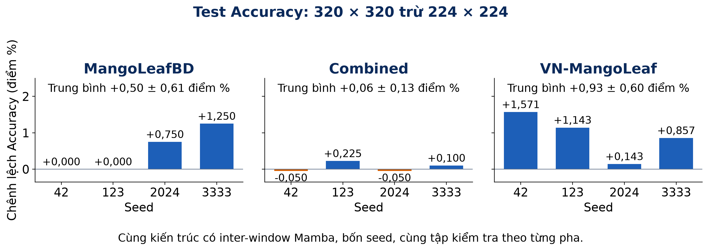

# So sánh cấu hình ảnh đầu vào và window size

Thí nghiệm so sánh MangoMamba có inter-window Mamba ở stage 1 trên cùng ba bộ dữ liệu và bốn seed 42, 123, 2024, 3333. Hai cấu hình lần lượt dùng đầu vào 224 × 224 với window size [7, 7, 7, 7] và 320 × 320 với window size [8, 8, 5, 5]. Mỗi cấu hình đi qua MangoLeafBD, Bộ dữ liệu kết hợp, rồi VN-MangoLeaf. Mỗi pha dùng checkpoint tốt nhất của pha trước theo cùng seed.

| Tập kiểm tra | 224 Accuracy (%) | 320 Accuracy (%) | Chênh lệch ghép cặp (điểm %) |
|---|---:|---:|---:|
| MangoLeafBD | 99,19 ± 0,38 | 99,69 ± 0,24 | +0,50 ± 0,61 |
| Bộ dữ liệu kết hợp | 99,43 ± 0,10 | 99,48 ± 0,07 | +0,06 ± 0,13 |
| VN-MangoLeaf | 97,96 ± 0,34 | 98,89 ± 0,29 | +0,93 ± 0,60 |

Giá trị là trung bình ± độ lệch chuẩn mẫu của bốn seed. Chênh lệch được tính cho từng seed, sau đó lấy trung bình và độ lệch chuẩn mẫu. Kích thước test lần lượt là 400, 4.000 và 700 ảnh.

`raw_records.json` lưu 24 kết quả gốc, nội dung cấu hình và đường dẫn nguồn trên ASUS. Bốn lượt pha 1 của cấu hình 224 được dùng lại từ kết quả trước đó. Trong cấu hình đã lưu, input_size của bốn lượt này là null; kiểm tra bộ nạp dữ liệu với model và môi trường hiện tại trả về 224 × 224. Các lượt pha 2 và 3 ghi rõ input_size 224 × 224. Hai cấu hình thay đổi đồng thời kích thước ảnh và window size. Các seed dùng chung tập kiểm tra, vì vậy kết quả không xác định riêng ảnh hưởng của từng thay đổi.

Chạy `python plot_results.py` với matplotlib và PyYAML để tạo lại `per_seed.csv` và biểu đồ. Biểu đồ dùng test Accuracy từ `training_results.json`.

